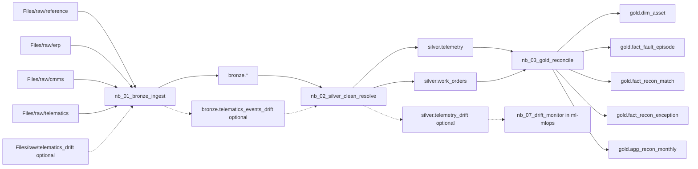

# Fabric ETL demo

## What this folder is
- Demo 2a of the Fabric end-to-end workshop.
- Focus: medallion ETL and reconciliation of equipment faults to work orders.
- Live target: about 25 minutes inside the 55-minute Fabric segment.

## Why this pattern
- One schema-enabled lakehouse keeps raw, conformed, and business tables together.
- PySpark notebooks show exactly where the rules live.
- The audience can see the jump from raw telemetry noise to reconciled business facts.

## Architecture

## Prerequisites
- Fabric capacity or trial.
- Workspace `ws-fleet-dev` on the workspace default runtime, Fabric Runtime 2.0 (Spark 4.1, Python 3.13), which Microsoft Learn lists as generally available and recommended. The ETL notebooks passed 39/39 metrics on local Spark 4.1.1 + Delta 4.2.0 and on local Spark 3.5.6 + Delta 3.2.1 [local runs, not a Fabric tenant]. Keep Runtime 1.3 (Spark 3.5, end-of-support-announced, Long Term Support through March 2027) only as the fallback if a notebook fails in Fabric. Menu path and dates: `rebuild-guide.md` section 3.
- Schema-enabled lakehouse `lh_fleet`.
- Raw data under `Files/raw`. After an upload, wait about 2 minutes before running `nb_00_setup` (file-listing cache, ⚠ UNVERIFIED duration; `rebuild-guide.md` section 4).
- Four imported notebooks with `lh_fleet` attached as the DEFAULT lakehouse, and the session restarted after attaching it. Imports and Git syncs do not carry that binding into a new workspace (`rebuild-guide.md` section 5).

## Time plan
| Step | Time |
|---|---:|
| Setup | 5 min |
| Bronze | 5 min |
| Silver | 8 min |
| Gold | 7 min |

## File index
| File / folder | Purpose |
|---|---|
| `notebooks-src\` | percent-format source of truth for the four notebooks |
| `notebooks\` | generated `.ipynb` imports |
| `fabric-git\*.Notebook\` | Fabric Git notebook representation |
| `fabric-git\pl_fleet_etl.DataPipeline\` | Fabric Git pipeline template |
| `tools\build_notebooks.py` | regenerates `.ipynb` and Fabric Git notebook folders |
| `local-validation\run_local.py` | local PySpark execution harness |
| `local-validation\compare_ground_truth.py` | compares the local run with the generator ground truth (39 checks) |
| `local-validation\requirements-spark35.txt` | exact pins of the Spark 3.5.6 + Delta 3.2.1 stack that passed 39/39 (the Runtime 1.3 line) |
| `local-validation\requirements-spark4.txt` | exact pins of the Spark 4.1.1 + Delta 4.2.0 stack that passed 39/39 (the Runtime 2.0 line) |
| `etl-facts-for-slides.md` | slide-author facts and code snippets |
| `run-of-show.md` | minute-by-minute live script |
| `rebuild-guide.md` | rebuild from empty tenant |
| `troubleshooting.md` | failure modes, seen in the local run or expected in Fabric |
| `VERIFY-BEFORE-FRIDAY.md` | rehearsal and verification checklist |
| `RESULTS.md` | local validation results against ground truth |

## What the demo produces
| Layer | Tables |
|---|---|
| Bronze | `telematics_events`, `cmms_work_orders`, `erp_assets`, `site_master`, `fault_code_catalog`, `asset_crosswalk`, `telematics_events_drift` (optional, ~15,367 rows) |
| Silver | `telemetry`, `work_orders`, `telemetry_drift` (optional, ~15,288 rows, feeds `nb_07_drift_monitor` in `ml-mlops`) |
| Gold | `dim_asset`, `dim_site`, `fact_telemetry_daily`, `fact_fault_episode`, `fact_work_order`, `fact_recon_match`, `fact_recon_exception`, `agg_recon_monthly` |

The two drift tables only appear when the rehearsal data was generated with `--with-drift`
(see `rebuild-guide.md`); they are written by the same `nb_01`/`nb_02` notebooks through a
shared silver function, not by a separate pipeline. See `RESULTS.md` for how the numbers were
validated and `CHANGES-for-slides.md` for the exact figures.

## When not to use this pattern
- When the main problem is low-latency streaming alerting rather than historical ETL.
- When schema inference and notebook-owned business logic are unacceptable for the operating model.
- When the audience needs a pure no-code ingestion story.
- When cross-workspace or cross-lakehouse data access is the main use case and you want explicit ABFSS-first code everywhere.

## Lab variant
### Goal
Participants reproduce bronze + silver in 30 minutes.

### Prerequisites
- Their own Fabric workspace on the default runtime (Runtime 2.0; Runtime 1.3 is the fallback), and a schema-enabled lakehouse.
- Raw data already uploaded to `Files/raw` (and at least 2 minutes old before `nb_00_setup` runs).
- The first three notebooks imported, with `lh_fleet` attached as the default lakehouse and the session restarted.

### Steps
1. Run `nb_00_setup`.
2. Run `nb_01_bronze_ingest`.
3. Verify bronze counts.
4. Run `nb_02_silver_clean_resolve`.
5. Verify:
   - `silver.telemetry` 207,691
   - late rows 2,066
   - duplicates removed 1,209
   - CMMS duplicates 6
   - CMMS time anomalies 8

### What not to include in the participant lab
- Gold reconciliation.
- Pipeline build.
- Any ML or data-agent steps.
