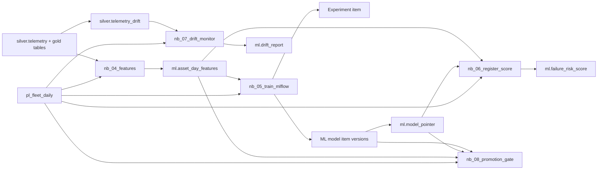

# Fabric ML and MLOps demo

This folder is Demo 2a-ML of the Fabric end-to-end workshop. It starts from reconciled fleet tables and shows feature engineering, MLflow experiment tracking, model registration, batch scoring, drift monitoring, a promotion gate, and an honest CI/CD story for Fabric ML items.

## What this is

- Audience: data scientists and data engineers
- Live segment length: about 30 minutes
- Lab variant: about 20 minutes for the train-and-track subset
- Data: synthetic only

## What this is not

- Not a managed online-serving demo
- Not a promise of built-in model stages or aliases in Fabric
- Not a first-party managed drift-monitoring service

## Architecture



## Promotion gate behavior

`nb_08_promotion_gate` always **computes** a champion/challenger decision, but the daily pipeline runs it report-only: `RunPromotionGate` passes no parameters, so `apply_pointer_update` stays at its default `False` and `ml.model_pointer` is never moved automatically. Scoring (`nb_06`) always serves the current champion from the pointer; the gate decides whether today's challenger should become tomorrow's champion -- that ordering is why scoring runs before the gate. A promotion is applied deliberately, by re-running `nb_08` with `apply_pointer_update = True` (see `rebuild-guide.md` section 8 for the auto-promote pipeline-parameter option, documented but not enabled).

## Prerequisites

- Capacity: a Trial capacity runs the notebooks and pipelines in this kit; only the Part 4
  data agent (and Copilot / AI functions) needs a paid F2+ capacity (same wording as
  `..\etl\rebuild-guide.md` section 2).
- Runtime: Pin the workspace to Fabric Runtime 1.3 (Spark 3.5, Python 3.11). This kit was rehearsed on that package set [the ML notebooks ran end to end on the Runtime 1.3 Python libraries (pandas 2.1.4, numpy 1.26.4, scikit-learn 1.2.2, pyarrow 14.0.2, mlflow-skinny 2.12.2) and reproduced the contract: counts exact, metrics within the +/-0.03 tolerance; this was a local Python plus simulated-Fabric run, not a Fabric tenant]. Runtime 2.0 (Spark 4.1, Python 3.13) is the newer runtime; the Python/ML code was also run on a Runtime-2.0-like package set, but the ETL notebooks were not rehearsed on Spark 4.1, so pin 1.3 for the whole demo workspace. Set it in the workspace Spark settings (see the ETL guide, `..\etl\rebuild-guide.md` section 3).
- The ETL half of the demo already ran and produced the gold tables (`gold.*`) plus
  `silver.telemetry`, `silver.telemetry_drift`, and `bronze.fault_code_catalog`.
- Break-glass if the ETL tables are missing: run
  `06-demo-foundry-data-agent\fabric-setup\nb_10_load_gold_break_glass.py` (outside
  this folder) to load `gold.*` and `ml.*` reference outputs, then **skip `nb_04`
  (features) and `nb_07` (drift monitor)** -- nb_10 already loads
  `ml.asset_day_features` and `ml.drift_report` directly -- and run `nb_05` ->
  `nb_06` -> `nb_08` only. `pl_fleet_daily` itself cannot run end to end without the
  real ETL tables (its first three activities are `nb_01`-`nb_03`); the break-glass
  path is a manual notebook-by-notebook fallback, not a pipeline run.
- A workspace with a schema-enabled lakehouse named `lh_fleet`.
- Notebook default lakehouse attached correctly.
- The `notebooks\` folder (`__init__.py`, `notebook_common.py`, `shared\*.py`)
  uploaded to `lh_fleet`'s `Files/code/notebooks/...` (see "Sharing code across
  notebooks" below) -- every ML notebook imports from it.

## Time plan

| Segment | Minutes |
|---|---:|
| Features | 4 |
| Train and track | 8 |
| Register and score | 5 |
| Pipeline | 5 |
| Drift | 4 |
| CI/CD | 4 |

## File index

- `mlops-facts-for-slides.md` — facts and code quotes for slide authoring
- `run-of-show.md` — 30-minute and 18-minute presenter path
- `rebuild-guide.md` — exact rebuild steps
- `drift-alert-recipe.md` — pipeline and Activator alert options
- `troubleshooting.md` — symptom/cause/fix table
- `VERIFY-BEFORE-FRIDAY.md` — every preview or unverified point to re-check
- `notebooks\` — percent-format notebook sources (source of truth) and generated `.ipynb`
- `fabric-git\` — Fabric Git-format folders for import: `nb_04..nb_08.Notebook`, `fleet_mlops.VariableLibrary`, `pl_fleet_daily.DataPipeline`
- `local-validation\` — local runner, tests, comparison scripts, and the optional ETL-to-ML integration check (`integration_etl_to_ml.py`)
- `cicd\` — deployment automation, workflow, and CI/CD notes

## ETL to ML integration check

Optional, local, plain Python (no Spark, no Fabric tenant). `local-validation\run_local.py` feeds the ML notebooks pandas tables built from the raw CSVs; `local-validation\integration_etl_to_ml.py` feeds them the Delta tables the ETL notebooks really wrote (default `..\etl\local-validation\artifacts`, so run the ETL validation first). It reads each table through its Delta log (active files only, never a blind glob of the parquet parts) and converts it the way `spark.table(...).toPandas()` does in Fabric: `date` becomes `datetime.date`, `array<string>` becomes a list, timestamps become `datetime64[ns]`.

```text
python local-validation\integration_etl_to_ml.py                          # 14 checks, 4 to 8 minutes depending on the machine
python local-validation\integration_etl_to_ml.py --features-only          # nb_04 + nb_07 only, about 10 seconds
python local-validation\integration_etl_to_ml.py --tables-root <folder> --out <short folder>
```

It prints a PASS / FAIL table and writes `integration-etl-to-ml-summary.json` to the out folder. Exit code 0 = every check passed, 1 = a check failed, 2 = no tables found. It checks, against the frozen contract in `02-demo-data\reference_out`:

- the six ML input tables read and the gold row counts (316 assets, 51,353 telemetry days, 2,345 work orders);
- `nb_04`: counts, keys and labels identical, and the 42 features within one 1e-4 rounding step (see below);
- `nb_07`: the drift table equals the reference (4 major / 3 moderate / 40 stable);
- `nb_05` (run twice), `nb_06`, `nb_08`: HGB metrics within +/-0.03 of the contract, 264 assets scored, bands within +/-2, reason codes equal to the frozen file, gate decision recorded (report-only).

Feature rule: keys, labels, counts and the NaN pattern must be identical. `nb_04` rounds the features to 4 decimals and Spark sums the daily means in a different float order than pandas, so about 0.03 % of the cells (603 of 2.1 million) sit on a rounding tie and land one 1e-4 step from the reference; that is accepted, anything larger fails. Results are in `RESULTS.md`. Pass `--out` with a short folder on a deeply nested Windows checkout, so MLflow artifact paths stay below the MAX_PATH limit.

## Sharing code across notebooks

`nb_04`-`nb_08` all do `from notebooks.notebook_common import ...` /
`from notebooks.shared... import ...`. No `notebooks` package exists in a fresh Fabric
workspace, so this kit's decision is: **upload the code folder into the lakehouse
Files area.** Steps: upload the whole `notebooks\` folder (via the portal's Upload
folder action, or OneLake file explorer / `azcopy`) to `lh_fleet`'s
`Files/code/notebooks/...`, keeping `__init__.py`, `notebook_common.py`, and
`shared\*.py`; attach `lh_fleet` as each notebook's default lakehouse (see section 3 of
`rebuild-guide.md`). The generator injects a first code cell into every Fabric Git
notebook that adds `/lakehouse/default/Files/code` (overridable with the
`FLEET_CODE_DIR` environment variable) to `sys.path` only when `notebookutils` is
present; outside Fabric it is a no-op and `run_local.py`'s own `sys.path` setup is used
instead.

Other ways to share code in Fabric, not used by this kit:

| Approach | How it works | Status here |
|---|---|---|
| Environment item with a custom wheel | Build the `notebooks` package as a wheel, attach it to a Fabric Environment, attach the Environment to each notebook | ⚠ UNVERIFIED -- the production-grade approach, not built for this workshop |
| `%run` a library notebook | Keep shared code in its own notebook, `%run` it from each consumer notebook | ⚠ UNVERIFIED -- simple but couples code to a notebook item, no plain-Python authoring |
| Notebook Resources folder | Attach files under a notebook's own Resources folder, read via a relative path | ⚠ UNVERIFIED -- `fabric-cicd` does NOT deploy Resources folders today, so this would break CI/CD |

## When NOT to use this pattern

- When you need a managed online feature store or strict real-time serving SLA
- When you require built-in multi-environment model registry promotion semantics
- When you need first-party managed drift monitoring rather than a notebook-based detector
- When your demo cannot tolerate any Spark-session warm-up or metadata lag

## Lab variant

For participants, keep only:
1. `nb_04_features`
2. `nb_05_train_mlflow`

Target time: 20 minutes.

Skip:
- pipeline authoring
- drift alerting
- gate pointer update

Expected participant outputs:
- one feature table
- one experiment with five candidate runs
- one registered model version
