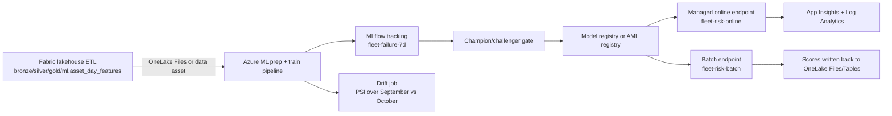

# Azure ML end-to-end demo

This folder is the Azure Machine Learning half of Part 3. The story is simple: Fabric owns the lakehouse and the ETL, Azure ML owns the production-style ML workflow. The hand-off is `ml.asset_day_features` exported to OneLake `/Files`, ADLS, or an AML data asset. From there the data scientists train, evaluate, register, deploy, monitor, and promote the same fleet failure-prediction model with Azure ML v2, MLflow 2.16.2, Bicep, and GitHub Actions.



## Prerequisites

1. Azure CLI with the `ml` extension v2 and Bicep.
2. Python 3.11 for the offline checks and CI only: `pip install -r requirements-local.txt` (pinned, see below). The Azure ML jobs themselves run in the environment defined by `environments\conda-fleet-sklearn.yml`, not in your local Python.
3. An Azure subscription with quota for `Standard_DS3_v2` in the chosen EU region.
4. The input features. The default path needs nothing more: the data assets in `jobs\data-*.yml` point at `..\..\02-demo-data\reference_out\`, so keep this folder next to `02-demo-data`. The hybrid path reads `ml.asset_day_features` from a Fabric lakehouse through the optional OneLake datastore (see `bridge-fabric-aml.md`).
5. GitHub OIDC set up for the repo if you want to run the workflow templates. The templates assume the repository root is the workshop folder (the one that contains `05-demo-azureml-e2e\`).

## Architecture decisions

- **AML over Fabric ML** when you need managed online endpoints, batch endpoints, explicit blue/green rollout, registry-driven promotion, AML schedules, or GitHub/Azure IaC separation.
- **Fabric over AML** when the workload is lake-centric, notebook-centric, or tightly coupled to Power BI and semantic models.
- **Hybrid pattern for the workshop:** Fabric ETL -> OneLake `/Files` -> Azure ML training. That keeps heavy reconciliation in the lake engine and keeps MLOps in the dedicated ML platform.
- **ACR choice:** this implementation deploys a dedicated ACR in Bicep instead of letting AML create one on the first image build. It costs a little more but removes a live-demo timing variable and makes pre-building the environment predictable.

## Time plan

| Segment | Minutes | Notes |
|---|---:|---|
| Infra and workspace tour | 5 | Show workspace, compute, environment, and why AML is in the story |
| Training pipeline live | 12 | Submit prep/train/evaluate/gate/register |
| Registry and metrics | 6 | Compare runs, show PR-AUC, explain the gate |
| Managed online endpoint | 8 | Blue is live, green is deployed, smoke-test request, mirror to green, then shift traffic |
| Batch endpoint | 5 | Trigger asynchronous scoring |
| Monitoring and MLOps | 9 | PSI drift, schedules, GitHub Actions, dev->test->prod promotion |

## Lab variants (optional homework)

Slide P3.24 offers two Azure ML labs. Each one reuses steps from `rebuild-guide.md`, so nothing extra has to be built. The times assume the prerequisites are already in place, and they are estimates, not measurements from a real tenant.

| Lab | Time | Needs | Do | It worked when |
|---|---:|---|---|---|
| Train and track | 20 min | The workspace, `cpu-cluster`, and everything registered in step 2 of the rebuild guide | Submit `jobs\command-job-train.yml` (one training job, no gate, no registration) and open the run in Studio | The run shows MLflow metrics, with `test_pr_auc` about 0.385 (plus or minus 0.03) and `test_roc_auc` about 0.75, and a model artifact that carries a signature |
| Deploy one endpoint | 30 min | A registered `fleet-failure-7d` model (run the training pipeline of step 3 once), `Standard_DS3_v2` quota, ACR access | Step 5 with the blue deployment only, then the first `invoke` of step 6 | The invoke returns three probabilities and blue carries 100 % of the traffic |

## File index

| Path | Purpose |
|---|---|
| `infra\` | Bicep for workspace, dependencies, compute, RBAC, and optional registry |
| `environments\` | AML environment YAML plus pinned Conda definition |
| `src\` | AML scripts using the shared `fleet_ml_core.py` unchanged |
| `assets\` | `champion-metrics.json`: the frozen baseline metrics the gate compares against (registered as data asset `fleet-champion-metrics:1`) |
| `jobs\` | Command components, pipeline, sweep, data assets, schedule, monitoring sample, optional OneLake datastore |
| `endpoints\` | Online and batch endpoint YAML, sample request, invoke helpers, rollout commands |
| `sdk\` | Python SDK equivalents for pipeline, sweep, online deploy, and batch run |
| `mlops\` | GitHub Actions templates and OIDC/registry/MLOps docs |
| `tests\` | pytest checks for the gate rule and the contract scripts |
| `local-validation\` | `run_local.py` (offline end-to-end simulation against the reference data), `validate_with_sdk_loaders.py` (authoritative YAML/SDK check) and `validate_yaml_schemas.py` (secondary JSON-schema check) |
| `results\` | Small JSON/text outputs of the one offline run (gate decision, drift and score summaries) |
| `requirements-local.txt` | Pinned packages for the offline checks and CI (not for the AML jobs) |
| `bridge-fabric-aml.md` | Fabric/Azure ML interoperability guidance, including the optional OneLake datastore |

Start with `rebuild-guide.md` (exact rebuild from an empty subscription) and `run-of-show.md` (live script). `VERIFY-BEFORE-FRIDAY.md` lists what only a real tenant can confirm, `troubleshooting.md` the failures seen or expected, and `cost-and-cleanup.md` the cost and teardown.

## Check the kit offline

Nothing here needs an Azure subscription. From this folder:

```powershell
py -3.11 -m venv .venv
.venv\Scripts\python -m pip install -r requirements-local.txt
.venv\Scripts\python local-validation\validate_with_sdk_loaders.py   # 23 YAMLs + SDK pipeline + asset references: expect "All checks passed"
.venv\Scripts\python -m pytest -q tests
.venv\Scripts\python -m ruff check src tests sdk local-validation
.venv\Scripts\python local-validation\run_local.py                  # offline prep, train, evaluate, gate, register, score, drift; writes to local-validation\out (safe to delete)
```

`validate_with_sdk_loaders.py` loads every YAML with the same azure-ai-ml loaders the `az ml` CLI uses, so it catches what a plain YAML parse or the public JSON schemas miss. It still cannot replace one real `az ml ... create` in a scratch resource group: see `VERIFY-BEFORE-FRIDAY.md`.
